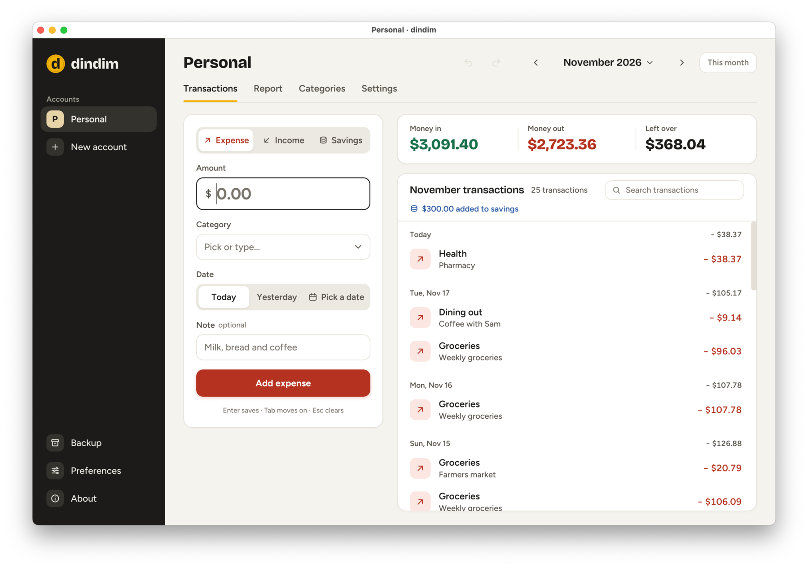
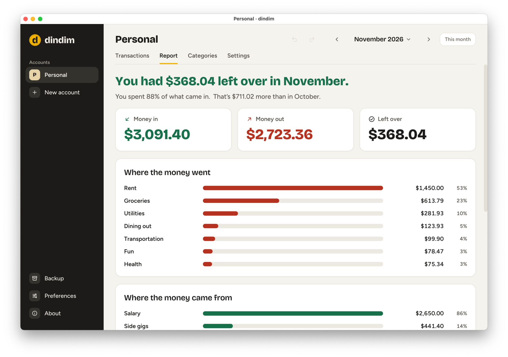

<div align="center">


# dindim

**A fast, private expense tracker for your desktop.**

Jot down what comes in and what goes out, and see where your money went in plain words.
Everything stays on your computer.

[](https://github.com/thdtr/dindim/actions/workflows/ci.yml)
[](https://github.com/thdtr/dindim/releases)
[](LICENSE)


English · [Português (Brasil)](README.pt-BR.md)



</div>

## Why dindim

Most budgeting apps want an account, a subscription and access to your bank. dindim wants none of that. It's a small desktop app that opens in a blink, lets you log a purchase in about two seconds, and tells you how the month went in a sentence anyone can read, like “You had $732.57 left over in November.”

## Features

- Logging is built for the keyboard. Type the amount, a few letters of the category and a note, then hit Enter. You can even type sums like `10 + 5.50`.
- Every account starts with a clean slate and builds its own list of categories. When you need a new one, create it right from the entry form.
- The report reads like a person wrote it. It shows spending by category, how the month compares with the last one, and the whole year in a chart.
- Emergency savings live apart from everyday spending, so you always know what you set aside and what you took out.
- Keep several accounts side by side, like yours, the household's and a parent's you help out, each in its own currency.
- Any account can have a password. With one, its file is encrypted with SQLCipher (AES-256).
- Undo and redo work for transactions and categories.
- Search looks through every month at once, by note, category or amount.
- Backups go into a single `.zip`, and dindim also makes one on its own every day.
- CSV export and import let you take your data to a spreadsheet and back.
- There are light and dark themes, zoom, and shortcuts for everything you do often.
- The app speaks English and Brazilian Portuguese, following your system or your choice in Preferences.

<div align="center">

</div>

## Install

### Linux and macOS

Open a terminal and run

```bash
curl -fsSL https://raw.githubusercontent.com/thdtr/dindim/main/scripts/install.sh | sh
```

On Linux, the app goes to `~/.local/bin` and shows up in your app menu. On macOS, it goes to the Applications folder in your home folder. No `sudo` needed.

### Windows

Open PowerShell and run

```powershell
irm https://raw.githubusercontent.com/thdtr/dindim/main/scripts/install.ps1 | iex
```

dindim shows up in the Start menu. If you'd rather click through an installer, download `dindim-…-windows-x86_64-setup.exe` from the [releases page](https://github.com/thdtr/dindim/releases).

### About the security warnings

dindim is free and made by volunteers, so its builds aren't signed with a paid Microsoft or Apple certificate. Your system will warn you the first time you open an installer or app downloaded from the browser. That's expected, and every release lists a SHA-256 checksum and a build provenance attestation so you can check that the file came from this repository.

**Windows.** A blue window says “Windows protected your PC”. Click **More info**, then **Run anyway**.

**macOS.** If you downloaded the `.dmg` in your browser, macOS says it can't verify the app the first time you open it. Close the warning, open **System Settings**, go to **Privacy & Security**, scroll down and click **Open Anyway** next to the message about dindim. The install command above doesn't run into this.

### Uninstall

```bash
curl -fsSL https://raw.githubusercontent.com/thdtr/dindim/main/scripts/install.sh | sh -s -- --uninstall
```

On Windows, if you used the installer, remove dindim from **Settings › Apps**. If you used the command, run

```powershell
& ([scriptblock]::Create((irm https://raw.githubusercontent.com/thdtr/dindim/main/scripts/install.ps1))) -Uninstall
```

Uninstalling never deletes your data.

## Your data

Each account is one file in your data folder.

| System | Data folder |
| --- | --- |
| Linux | `~/.local/share/dindim` |
| macOS | `~/Library/Application Support/dindim` |
| Windows | `%APPDATA%\dindim\data` |

To move to a new computer, use **Backup › Export** and then **Import** on the other side. Importing never overwrites anything. The [security notes](SECURITY.md) explain exactly what a password protects.

### CSV files

Exports use the same format in every language, so they open anywhere.

```csv
date,type,amount,category,note
2026-11-03,expense,1200.00,Rent,November
2026-11-05,income,3500.50,Salary,
2026-11-06,reserve_deposit,200.00,,
```

The type is `expense`, `income`, `reserve_deposit` or `reserve_withdrawal`. Amounts use a period for decimals. Categories that don't exist yet are created when you import.

## Keyboard shortcuts

On macOS, use ⌘ instead of Ctrl.

| Keys | What they do |
| --- | --- |
| Ctrl+N | New transaction |
| Ctrl+F | Search |
| Ctrl+Z / Ctrl+Shift+Z | Undo / redo |
| Ctrl+1 to Ctrl+4 | Switch tabs |
| PageUp / PageDown | Previous / next month |
| Ctrl+L | Close the current account |
| Ctrl+= / Ctrl+- | Zoom in / out |
| Esc | Close a panel, cancel an edit, clear the form |

## Build from source

You need [Rust](https://rustup.rs) 1.92 or newer and Perl (already on macOS and most Linux systems).

```bash
git clone https://github.com/thdtr/dindim
cd dindim
cargo run --release -p dindim
```

## Contributing

Bug reports, translations and pull requests are welcome. [CONTRIBUTING.md](CONTRIBUTING.md) explains how the code is laid out and how to add a language. Please follow the [code of conduct](CODE_OF_CONDUCT.md).

## License

dindim is free software under the [Apache License 2.0](LICENSE). The bundled typefaces, Figtree and Bricolage Grotesque, are under the SIL Open Font License.
