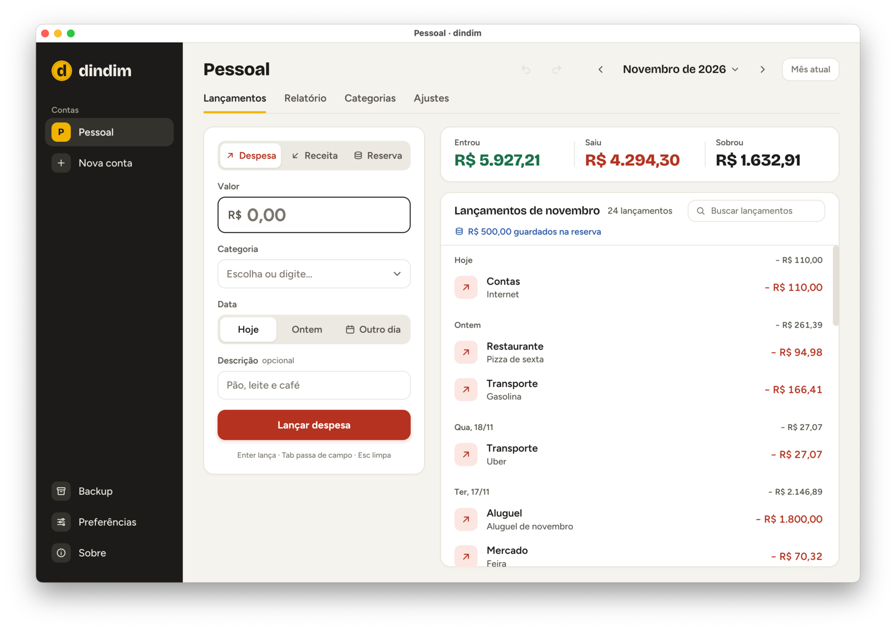
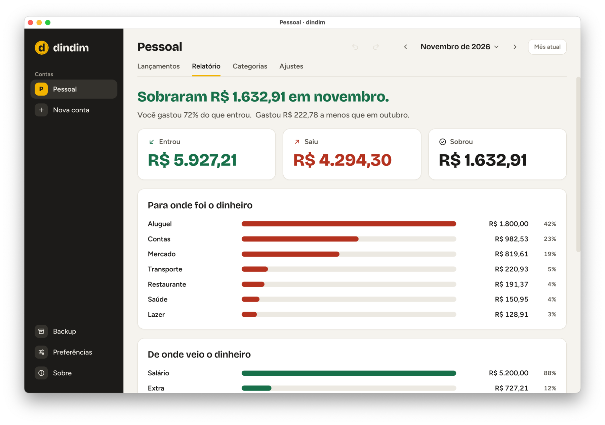

<div align="center">


# dindim

**Controle de gastos rápido e privado, direto no seu computador.**

Anote o que entra e o que sai e veja, em palavras simples, para onde foi o seu dinheiro.
Nada sai do seu computador.

[](https://github.com/thdtr/dindim/actions/workflows/ci.yml)
[](https://github.com/thdtr/dindim/releases)
[](LICENSE)


[English](README.md) · Português (Brasil)



</div>

## Por que o dindim

A maioria dos apps de finanças pede cadastro, assinatura e acesso ao seu banco. O dindim não pede nada disso. É um programa leve que abre na hora, deixa você lançar uma compra em uns dois segundos e conta como foi o mês numa frase que qualquer um entende, tipo “Sobraram R$ 1.891,82 em novembro.”

## O que ele faz

- O lançamento foi pensado para o teclado. Digite o valor, o começo da categoria e uma descrição e aperte Enter. Dá até para somar na hora, como `10 + 5,50`.
- Toda conta começa do zero e vai criando as próprias categorias. Quando precisar de uma nova, é só criar ali mesmo no formulário.
- O relatório conta o mês do jeito que a gente fala. Mostra os gastos por categoria, a comparação com o mês anterior e o ano inteiro num gráfico.
- A reserva de emergência fica separada dos gastos do dia a dia, então você sempre sabe quanto guardou e quanto tirou.
- Dá para ter várias contas lado a lado, como a sua, a da casa e a dos seus pais, cada uma com a própria moeda.
- Qualquer conta pode ter senha. Com senha, o arquivo fica criptografado com SQLCipher (AES-256).
- Lançamentos e categorias têm desfazer e refazer.
- A busca procura em todos os meses de uma vez, por descrição, categoria ou valor.
- O backup junta tudo num único `.zip`, e o dindim ainda faz um sozinho todo dia.
- A exportação e a importação em CSV levam seus dados para uma planilha e trazem de volta.
- Tem tema claro e escuro, zoom e atalhos para o que você faz toda hora.
- O app fala português do Brasil e inglês, seguindo o seu sistema ou a sua escolha em Preferências.

<div align="center">

</div>

## Como instalar

### Linux e macOS

Abra o terminal e rode

```bash
curl -fsSL https://raw.githubusercontent.com/thdtr/dindim/main/scripts/install.sh | sh
```

No Linux, o app vai para `~/.local/bin` e aparece no menu de aplicativos. No macOS, ele vai para a pasta Aplicativos dentro da sua pasta pessoal. Não precisa de `sudo`.

### Windows

Abra o PowerShell e rode

```powershell
irm https://raw.githubusercontent.com/thdtr/dindim/main/scripts/install.ps1 | iex
```

O dindim aparece no menu Iniciar. Se preferir um instalador com janelinhas, baixe o `dindim-…-windows-x86_64-setup.exe` na [página de versões](https://github.com/thdtr/dindim/releases).

### Sobre os avisos de segurança

O dindim é gratuito e feito por voluntários, então os arquivos não são assinados com um certificado pago da Microsoft ou da Apple. Por isso o sistema mostra um aviso na primeira vez que você abre um instalador ou app baixado pelo navegador. Isso é normal. Toda versão traz o checksum SHA-256 e um atestado de procedência, para você conferir que o arquivo saiu mesmo deste repositório.

**Windows.** Aparece uma janela azul dizendo “O Windows protegeu o computador”. Clique em **Mais informações** e depois em **Executar assim mesmo**.

**macOS.** Se você baixou o `.dmg` pelo navegador, o macOS diz que não consegue verificar o app na primeira vez que você abre. Feche o aviso, abra os **Ajustes do Sistema**, entre em **Privacidade e Segurança**, role a tela até o fim e clique em **Abrir Mesmo Assim**, ao lado da mensagem sobre o dindim. Quem instala pelo comando acima não passa por isso.

### Como desinstalar

```bash
curl -fsSL https://raw.githubusercontent.com/thdtr/dindim/main/scripts/install.sh | sh -s -- --uninstall
```

No Windows, se você usou o instalador, remova o dindim em **Configurações › Aplicativos**. Se instalou pelo comando, rode

```powershell
& ([scriptblock]::Create((irm https://raw.githubusercontent.com/thdtr/dindim/main/scripts/install.ps1))) -Uninstall
```

Desinstalar nunca apaga os seus dados.

## Seus dados

Cada conta é um arquivo na sua pasta de dados.

| Sistema | Pasta de dados |
| --- | --- |
| Linux | `~/.local/share/dindim` |
| macOS | `~/Library/Application Support/dindim` |
| Windows | `%APPDATA%\dindim\data` |

Para levar tudo para outro computador, use **Backup › Exportar** e depois **Importar** no computador novo. Importar nunca apaga nada. As [notas de segurança](SECURITY.md) (em inglês) explicam direitinho o que a senha protege.

### Arquivos CSV

O CSV tem o mesmo formato em qualquer idioma, para abrir em qualquer lugar.

```csv
date,type,amount,category,note
2026-11-03,expense,1800.00,Aluguel,Novembro
2026-11-05,income,5200.00,Salário,
2026-11-06,reserve_deposit,500.00,,
```

O tipo é `expense` (despesa), `income` (receita), `reserve_deposit` (guardar na reserva) ou `reserve_withdrawal` (tirar da reserva). Os valores usam ponto nos centavos. Categorias que ainda não existem são criadas na importação.

## Atalhos de teclado

No macOS, use ⌘ no lugar de Ctrl.

| Teclas | O que fazem |
| --- | --- |
| Ctrl+N | Novo lançamento |
| Ctrl+F | Buscar |
| Ctrl+Z / Ctrl+Shift+Z | Desfazer / refazer |
| Ctrl+1 a Ctrl+4 | Trocar de aba |
| PageUp / PageDown | Mês anterior / seguinte |
| Ctrl+L | Fechar a conta aberta |
| Ctrl+= / Ctrl+- | Aumentar / diminuir o zoom |
| Esc | Fecha um painel, cancela a edição e limpa o formulário |

## Compilar a partir do código

Você precisa do [Rust](https://rustup.rs) 1.92 ou mais novo e do Perl (que já vem no macOS e na maioria das distribuições Linux).

```bash
git clone https://github.com/thdtr/dindim
cd dindim
cargo run --release -p dindim
```

## Como contribuir

Relatos de bugs, traduções e pull requests são muito bem-vindos. O [CONTRIBUTING.md](CONTRIBUTING.md) (em inglês) explica como o código está organizado e como adicionar um idioma. Pedimos que todos sigam o [código de conduta](CODE_OF_CONDUCT.md).

## Licença

O dindim é software livre, distribuído sob a [Licença Apache 2.0](LICENSE). As fontes incluídas, Figtree e Bricolage Grotesque, são distribuídas sob a SIL Open Font License.
